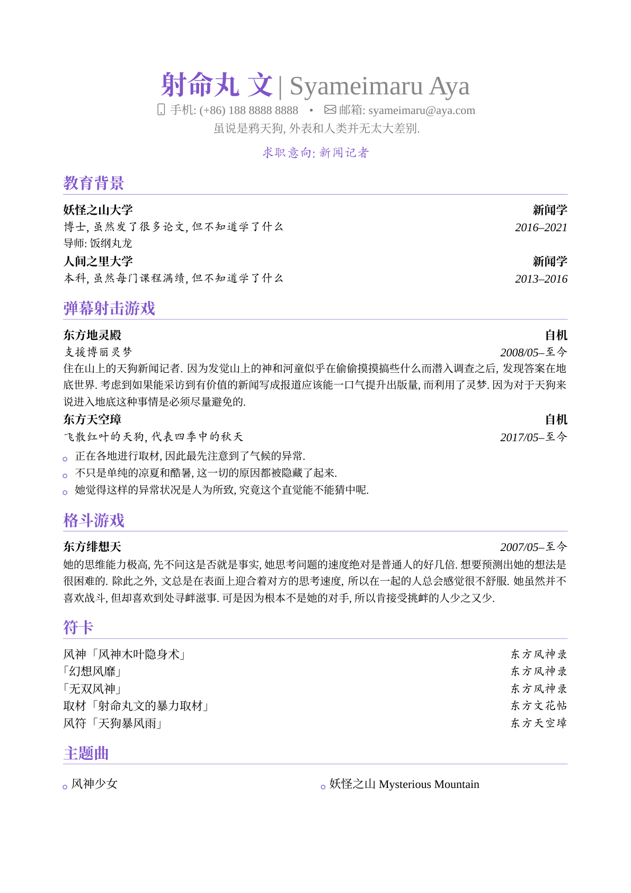

# AyaCV · Typst

[AyaCV](https://github.com/AyaTheCrow/AyaCV) 的 Typst 改写，采用宋体正文、楷体说明和细线分节。原版基于 [ModernCV](https://github.com/xdanaux/moderncv) 的 banking 主题。

## 使用

安装 [Typst](https://typst.app/open-source/) 和 Python 3，然后运行：

```sh
python3 scripts/install-fonts.py
typst compile --font-path .fonts resume.typ ayacv.pdf
```

修改 `resume.typ`，填写自己的简历。

## 字体

| 字体 | 用途 |
| --- | --- |
| 思源宋体 | 中文正文与标题 |
| 文鼎楷体 | 中文说明与强调 |
| Liberation Serif | 英文与数字 |


